# OffWallet

A Bitcoin taproot wallet that runs on a Game Boy Color.

No radio, no network stack, no operating system, nothing that updates itself.
The private key is generated on the console from 128 coin flips you watch land,
and it never leaves the cartridge. The cryptography is real: secp256k1
arithmetic written for an 8-bit CPU, addresses that match the official BIP-86
test vectors.

The interface is the opening of a monster-collecting game, because the parts
that matter — collecting randomness, then waiting out a slow computation — are
what that opening is made of.

<p align="center">
  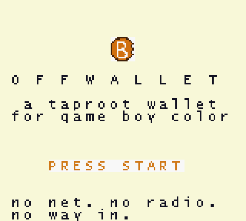
  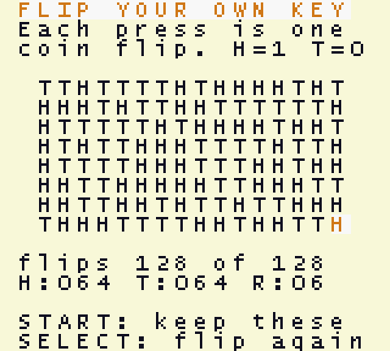
  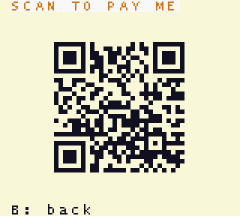
</p>

## What it is

An air-gapped key generator and cold store. The console has no Wi-Fi, no
Bluetooth, no cellular and no USB data path. It has no operating system, no
services and no auto-update. The only ways in or out are the screen, the
speaker and eight buttons. There is no network code in the ROM because there is
nothing for it to talk to, and the 128 KB image you build is the image that
runs every time you power it on.

It does not sign transactions. That is deliberate: a wallet that signs badly is
worse than one that does not sign at all. OffWallet makes the key and keeps it;
to spend, you import the secret into software that handles fees, change and
broadcast. See [Spending from it](#spending-from-it).

## How to use it

Copy `OFFWALL.GBC` onto the SD card of a flash cart, next to the cart's own
system folder, and boot it.

| | |
| --- | --- |
| 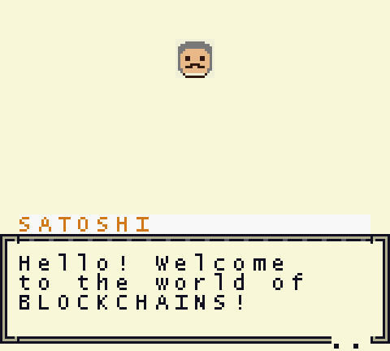 | **Talk to the professor.** Every line of dialogue, every screen and every character lives in [`content/story.txt`](content/story.txt), not in the C. |
| 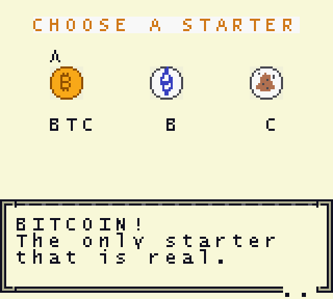 | **Pick a starter.** Bitcoin is the only one that hatched in this world. The other two refuse to be selected. |
| 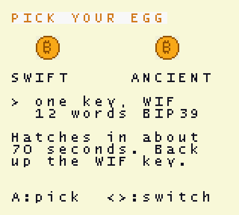 | **Pick an egg.** SWIFT is one standalone key, backed up as a WIF string, and hatches in about 70 seconds. ANCIENT is a 12-word BIP-39 seed phrase at `m/86'/0'/0'/0/0`, restorable in any wallet, and takes about 19 minutes. |
| 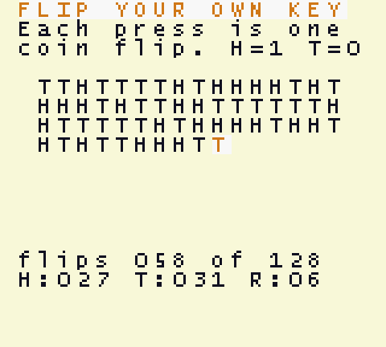 | **Flip your key.** One press, one coin flip, straight onto the grid. 128 flips, 128 bits. The counters show heads, tails and the longest run of the same result. |
|  | **Check the tally, then keep it.** 128 fair flips land near 64/64 with no run much past eight. `SELECT` throws the sequence away and starts again. |
| 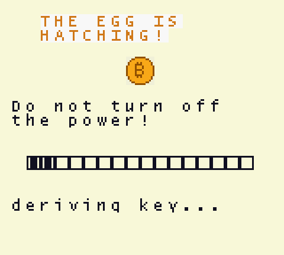 | **Wait for the hatch.** The bar is driven from the VBlank interrupt, so the screen keeps moving while the CPU grinds through the elliptic curve. |
| 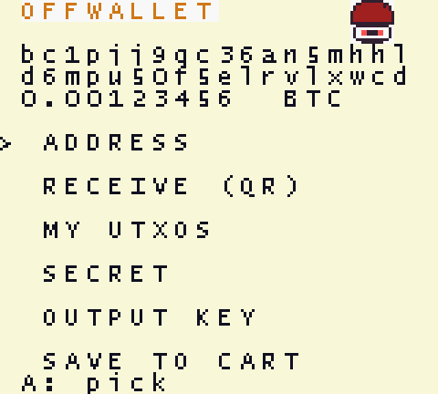 | **The wallet.** Address, QR code, your UTXO list and balance, the secret, the raw output key, and save-to-cartridge. |
| 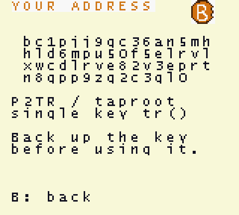 | **A real `bc1p…` address.** 62 characters of bech32m over four lines. |
|  | **Receive by QR.** Version 3, error-correction level L, 29×29 modules at three pixels each. A phone reads it straight off the screen. |
| 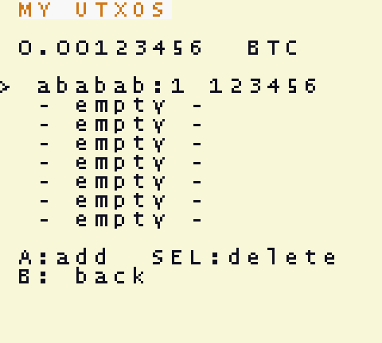 | **Your own ledger.** Transaction id, output index and amount, typed in from a block explorer, kept in cartridge SRAM with its own checksum. |
| 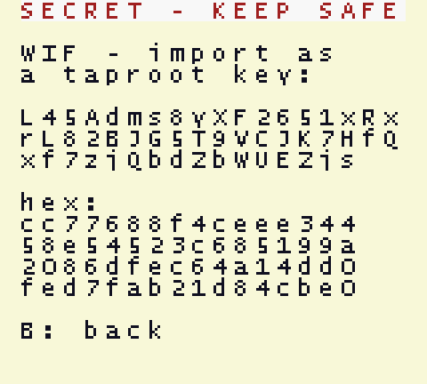 | **The secret**, as a WIF string and as raw hex. *(This key was generated by the emulator during a test run and is public. Never send coins to it.)* |

## How the key is made

The console has no hardware random number generator and no clock, so it does
not pretend to have one. Each button press is one coin flip, and the flip lands
on the grid the instant it happens.

The bit is the parity of the moment the press is detected. A counter races in a
tight polling loop, so detection is pinned to a few dozen clock cycles, and it
is read together with the hardware timer (262144 Hz, one tick every 3.8 µs),
the divider and the LCD line. A press cannot be aimed to the microsecond, so
the parity is a fair coin.

128 flips give 128 bits, the same strength as a 12-word seed phrase. Those bits
are the secret:

- **ANCIENT**: the flips *are* the BIP-39 entropy. Typing them into any other
  BIP-39 tool produces the same twelve words.
- **SWIFT**: the private key is `SHA-256(flips)`.

Either way the sequence you watched reproduces the wallet, and nothing about
the key comes from anywhere off-screen. The test suite checks exactly that: it
reads the `H`/`T` grid off the tile map and recomputes the key from it.

## Handling it

- **Flip your key on the real console, not in an emulator.** Scripted input has
  no timing jitter. The test harness gets the same flips on every run, by
  construction.
- **Read the tally before keeping the flips.** If it looks lopsided, press
  `SELECT` and flip again.
- **Copy the secret onto paper** before the address receives anything.
  Cartridge batteries die and SD cards rot.
- **The cartridge is a bearer instrument.** The key sits in plain cartridge
  SRAM, so whoever holds the cart holds the coins.
- **Nothing here is side-channel hardened.** The scalar multiplication's
  running time depends on the key's bit pattern.

## Spending from it

The wallet is a standard single-key P2TR output, so any modern wallet can take
it over.

**SWIFT (WIF).** An ordinary compressed-pubkey WIF. In Bitcoin Core:

```
bitcoin-cli createwallet "offwallet" true true
bitcoin-cli -rpcwallet=offwallet importdescriptors \
  '[{"desc":"tr(KyourWIFstring…)","timestamp":"now","active":false}]'
```

In Sparrow: *File → New Wallet → Script Type: Taproot (P2TR)*, then import the
private key.

**ANCIENT (12 words).** Type the words into any BIP-39 wallet, choose the
taproot / BIP-86 account, and the first receiving address is the one the Game
Boy showed.

Verify the address matches before sending anything. The `OUTPUT KEY` screen
shows the raw 32-byte x-only key so you can compare it against
`scriptPubKey = OP_1 <key>` in a block explorer.

## Customising it

Every screen, every line of dialogue and everyone you talk to lives in
[`content/story.txt`](content/story.txt). Edit that file and rebuild:

```
bash tools/build.sh game        # runs the content compiler, then links the ROM
```

`tools/gen/gen_story.py` turns the file into tables in bank 1 and checks it, so
a content mistake stops the build instead of shipping a screen with a word
chopped off at the edge. It catches over-long dialogue lines, text that would
run off the right edge from its starting column, sprite art that is not a
multiple of 8 pixels, unknown sprite/palette/character names, duplicate
sections, and required sections that have been renamed:

```
content/story.txt:222: dialogue line is 33 characters, the box fits 18: 'Hello there! …'
content/story.txt:97:  text at column 14 is 18 characters: 32 would run off the screen (max 6 here)
content/story.txt:144: unknown sprite 'chicken' (have: ball, btc, egg, prof)
content/story.txt: the game code needs [dialog congrats]; it is missing
```

| Section | What it does |
| --- | --- |
| `[screen id]` | Draw commands: `text x,y …`, `accent x,y …` (highlight), `warn x,y …` (red), `sprite x,y <id>`, `blank x,y,width`. `clear = no` draws over the previous screen. |
| `[dialog id]` | Boxes of up to 3 lines, `--` between boxes, `speaker = <character>` for a face and a name plate. |
| `[character id]` | `name`, `sprite`, `palette`, `portrait = x,y`. |
| `[sprite id]` | `png = art/<file>.png`, editable in any image editor. Multiples of 8 pixels, up to 4×4 tiles, at most 4 colours. ASCII art also works: 16 rows of 16 characters using `.` `-` `+` `#`. |
| `[palette id]` | Four `#RRGGBB` colours mapped onto the CGB's 5-bit channels. `text`, `warn` and `accent` are required; the rest are yours. |
| `[config]` | Which starter is unlocked, cursor positions, menu spacing, where the coin-flip grid sits. |

A screen is 20×18 tiles, so text starting at column *x* gets 20 − *x*
characters; dialogue lines get 18, because the box borders take two columns.

Palettes are the scarce resource. The console has eight background palettes;
`text`, `warn` and `accent` take three, leaving five for artwork. Every
distinct set of four colours claims one, and identical sets share
automatically. When they run out the build stops and names the sprite; add
`palette = <name>` to it to share another's colours.

A tile can only show four colours. If an image has more, the compiler keeps the
four most used, snaps the strays to the nearest, and says which:

```
note: art/prof.png uses 6 colours; keeping the four most common and
      snapping 2 stray pixel colour(s) to them
      #000000 (6 px) -> #382018
      #e8e8f0 (8 px) -> #f8f8e0
```

`python tools/run_content_test.py` boots the ROM in an emulator and compares
every text command in the content file against the tile map, character by
character at the exact coordinates, so an edit that does not reach the screen
is caught.

The generated files (`src/story_data.c`, `src/story_data.h`,
`src/story_tiles.c`) are build output. Don't edit them.

## Receiving, and the coin list

`RECEIVE (QR)` draws the address as a QR code: version 3, alphanumeric mode,
error-correction level L, 29×29 modules at 3 pixels each plus the 4-module
quiet zone, which is 111 of the 144 pixels the screen has. bech32m is
case-insensitive and its uppercase form fits QR's alphanumeric mode, which is
what keeps the code small enough to fit.

The encoder (`src/qr.c`) computes everything at run time — the GF(256) tables,
the generator polynomial, the format bits — and picks the mask by the four
penalty rules. `src/qr_draw.c` turns it into 196 unique tiles and puts them in
VRAM bank 1, so the 95-glyph font in bank 0 survives and the caption still
draws.

`MY UTXOS` is the list of coins the wallet believes it owns, in its own region
of cartridge SRAM with its own checksum, so an older save still loads. A Game
Boy has no network, so entries are typed in from a block explorer with a
picker: left/right to choose a character, A to append, B to rub out, START to
accept. The list gives the wallet a balance, and it is the data a spend needs.

## What is implemented

| Piece | Notes |
| --- | --- |
| SHA-256 | Full implementation, plus BIP-340 tagged hashes |
| SHA-512 / HMAC / PBKDF2 | 64-bit words as eight little-endian bytes (SDCC has no 64-bit type on SM83); rotations are byte permutations plus a ≤7-bit shift |
| secp256k1 field | 256-bit values as 32 little-endian bytes; reduction uses `2²⁵⁶ ≡ 2³² + 977` |
| Scalar multiplication | Lim–Lee comb, 8 teeth spaced 32 bits: 32 doublings, 32 table additions |
| Modular inversion | libsecp256k1's addition chain: 255 squarings + 15 multiplications |
| Taproot | BIP-341 tweak `Q = lift_x(P) + int(H_TapTweak(x(P)))·G`, no script tree (BIP-86) |
| Addresses | bech32m (BIP-350), witness version 1 |
| BIP-32 / BIP-39 | Hardened and normal derivation, English wordlist, `m/86'/0'/0'/change/index` |
| WIF | base58check of `0x80 ‖ key ‖ 0x01` |
| QR | Version 3-L, alphanumeric, GF(256) Reed–Solomon, all four mask penalty rules |

### The multiply

The SM83 has no multiply instruction. SDCC emulates each 8×8 product with a
helper call, and a field multiply needs 1024 of them: 167 ms each, which put a
single key derivation at over five minutes.

`src/crypto/fe_mul_sm83.s` replaces it with an algorithm that never multiplies.
It precomputes `b` shifted left by 0…7 bits, then for each set bit *k* of each
byte `a[i]` adds the *k*-th shifted copy into the accumulator at byte offset
*i*. Every inner step is a carry-chained 33-byte add, four instructions per
byte, using `dec b` as the loop counter because it leaves the carry flag alone.

That took a field multiply from 167 ms to 24 ms. With the C modular reduction
on top, the whole operation is 35.6 ms.

### SHA-512

BIP-39 mode is dominated by PBKDF2's 4096 SHA-512 compressions. Four
implementations were measured on hardware:

| SHA-512 compression | Per block | ANCIENT hatch |
| --- | --- | --- |
| C, 64-bit words as 32-bit hi/lo pairs | 1219 ms | 85 min |
| C, byte arrays, rotations as byte permutations | 1001 ms | 71 min |
| the same with every 8-byte loop unrolled | 1001 ms | 71 min |
| **SM83 assembly** (`src/crypto/sha512_sm83.s`) | **241 ms** | **~19 min** |

Unrolling the C bought 18% and then nothing. The cost is not loop overhead or
the shifts, it is SDCC emitting a pointer-indexed load, an add and a store for
every single byte. The assembly is 4.2× faster than the best C, verified
against it over 24 blocks on emulated hardware (`tools/run_sha_test.py`).

Three things make it cheaper:

- **Words are stored twice.** A 64-bit value occupies 16 bytes, the eight bytes
  repeated. A rotation by `8q + r` then reads eight *consecutive* bytes
  starting at offset `q`: no wrap-around test, no masking, `HL` walks forward.
  Writes cost an extra 8-byte mirror, which is cheaper than the masking it
  replaces.
- **The working variables are never copied.** `a`..`h` live in eight slots and
  a round writes only two of them: `d + T1` (the next `e`) and `T1 + T2` (the
  next `a`). Rotating a base index instead of the data removes six 8-byte
  copies per round.
- **Every primitive is unrolled** with the carry flowing between bytes:
  `ld a,(de) / adc a,(hl) / ld (hl+),a / inc de` is eight machine cycles per
  byte, and `inc de` leaves the carry flag alone.

It is generated by `tools/gen/gen_sha512_asm.py` rather than hand-written,
which keeps the ~1950 instructions consistent when a detail changes.

Roughly 40% of what is left is the rotations and another 40% the byte-wise
add/xor/copy primitives, both near the floor for this CPU. Fusing each rotation
triple into a single pass over the eight output bytes would save perhaps
another 20%. There is no algorithmic shortcut: BIP-39 mandates 2048 PBKDF2
iterations and each HMAC is exactly two compressions with the ipad/opad states
already precomputed.

### ROM layout

MBC5, 128 KB, CGB-only, battery-backed SRAM.

| Bank | Contents |
| --- | --- |
| 0 | Crypto core, coin flips, interrupt handler |
| 1 | Scenes, and the screens/dialogue/characters compiled from `content/story.txt` |
| 2 | secp256k1 comb table (16320 bytes) |
| 3 | BIP-39 English wordlist (2048 words at 8-byte stride) |
| 4 | SHA-512 (C and SM83 assembly), HMAC, PBKDF2 |
| 5 | Font and tiles |
| 6 | QR encoder and renderer |

Three banking rules account for most of the debugging time this project cost:

- **A function reached through a pointer must be in bank 0.** The VBlank
  handler and the crypto progress callbacks are called while the comb table's
  bank is mapped at `0x4000`. A pointer carries no bank number, so a handler in
  a switchable bank gets jumped into as table data. The symptom was the
  derivation hanging at 57%.
- **A bank-0 function that maps another bank must restore the caller's bank.**
  `secp_mul_g` maps bank 2 and returns into code that may itself live in bank 1.
  Forgetting this made the screen stay black from the first frame.
- **A function in a banked file, called from another bank, must be `BANKED`.**
  `sha512()` lives in bank 4; calling it as a plain function from bank 0 jumped
  into whatever bank happened to be mapped and quietly corrupted WRAM.

## Verifying it

Everything is checked against values computed somewhere else: the official BIP
vectors, or Python's own bignum and `hashlib`.

```
python tools/gen/gen_secp_tables.py     # regenerates tables, re-proving G is on
                                        # the curve, that order(G) == n, that p
                                        # and n are prime, and that the comb
                                        # table reproduces k·G
cd test
clang -O2 -std=c99 -o t_hash.exe  t_hash.c  ../src/crypto/{sha256,sha512,u64,hmac512}.c
./t_hash.exe > out_hash.txt             # compare against hashlib
clang -O2 -std=c99 -o t_secp.exe  t_secp.c  ../src/crypto/{sha256,secp256k1,secp256k1_comb,secp256k1_consts}.c
./t_secp.exe > out_secp.txt && python check_secp.py out_secp.txt
clang -O2 -std=c99 -o t_bip86.exe t_bip86.c ../src/crypto/*.c
./t_bip86.exe                           # the official BIP-86 vectors
```

Host results: 240 field operations and 12 scalar multiplications match Python
exactly, the 288 official BIP-39 vectors pass through the PBKDF2 path, and all
three BIP-86 vectors match on internal key, output key and address.

On emulated hardware, via PyBoy:

```
bash tools/build.sh testmul && python tools/run_mul_test.py   # asm vs C multiply
bash tools/build.sh testfe  && python tools/run_fe_test.py    # field/curve + timings
bash tools/build.sh game    && python tools/run_game_test.py swift
python tools/run_content_test.py                              # ROM vs content file
python tools/run_qr_test.py                                   # decode the QR
python tools/run_utxo_test.py                                 # the coin list
python tools/check_rom.py build/offwallet.gbc                 # ROM header
```

`run_game_test.py` walks the scenes by reading the tile map back as text (the
font is loaded so tile id == ASCII − 0x20), flips the 128 coins, waits out the
hatch, then recomputes the whole taproot derivation in Python from the private
key the ROM invented. It checks the ROM's internal key, output key and address;
the address, WIF and hex key as printed on screen; that the `H`/`T` grid on
screen is what the key was built from; then saves to SRAM, reboots, and checks
the wallet comes back identical.

`run_qr_test.py` points a real QR decoder at the emulator's framebuffer and
compares what it reads with the address.

## Performance on real hardware

Measured in double-speed CGB mode (8.4 MHz), in Game Boy seconds:

| Operation | Time |
| --- | --- |
| Field multiply (asm + C reduction) | 35.6 ms |
| SHA-512 compression (assembly) | 241 ms |
| Modular inversion | 10.0 s |
| Scalar multiplication `k·G` | 33.5 s |
| **SWIFT hatch** (2 scalar mults, 2 inversions) | **~70 s** |
| **ANCIENT hatch** (PBKDF2 2048 + BIP-32 + taproot) | **~19 min** |

## Building

Needs [GBDK-2020](https://github.com/gbdk-2020/gbdk-2020) 4.5.0 unpacked into
`tools/gbdk`, and Python 3 for the content compiler. The test suite
additionally wants clang and `pyboy==1.6.6` with `numpy<2`.

```
bash tools/build.sh game       # build/offwallet.gbc
bash tools/build.sh selftest   # crypto self-check ROM
bash tools/build.sh bench      # timing ROM
```

The generated tables (`secp256k1_comb.c`, `secp256k1_consts.c`,
`bip39_words.c`, `font_tiles.c`, `gfx_tiles.c`, `sha512_sm83.s`) are checked
in, so a normal build does not re-run the generators.

`python tools/deploy_sd.py D:` copies the ROM and the Italian quick-start onto
a mounted SD card and verifies each file by hash afterwards.
`python tools/shoot.py` regenerates the screenshots in this README.

A prebuilt ROM is in [`dist/OFFWALL.GBC`](dist/OFFWALL.GBC), with its md5 in
[`dist/SHA256SUMS.txt`](dist/SHA256SUMS.txt). Building from these sources with
the same GBDK release reproduces it byte for byte.

## Layout

```
content/story.txt                           all text, characters and screens
content/art/*.png                           the artwork, editable in any editor
src/
  main.c  game.c  ui.c  rng.c  progress.c   flow, drawing, coin flips, ISR
  story.c  story_data.c                     content interpreter + generated tables
  qr.c  qr_draw.c                           QR encoder (host-testable) + renderer
  utxo.c                                    the coin list and its entry widgets
  crypto/
    sha256.c  sha512.c  u64.c  hmac512.c    hashes
    sha512_sm83.s                           generated SM83 compression function
    secp256k1.c  fe_mul_sm83.s              curve arithmetic, hand-written multiply
    wallet.c  bip39.c  bech32.c  base58.c   BIP-32/39/86, addresses, WIF
  gfx/                                      font and tiles
test/                                       host tests and the official BIP vectors
tools/                                      build script, emulator harnesses
tools/gen/                                  table, font, art and assembly generators
docs/shots/                                 the screenshots above, made by tools/shoot.py
```

## Licence

MIT. See [LICENSE](LICENSE).
